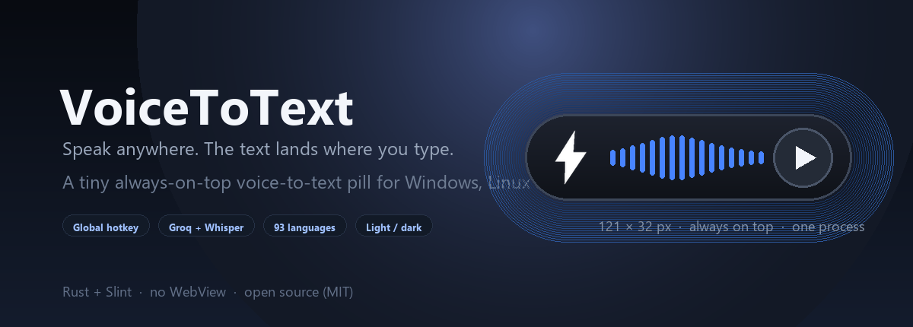

<p align="center">
  <a href="https://github.com/sergio-dev1-py/openSpeakVoice">
    
  </a>
</p>

<h1 align="center">VoiceToText</h1>

<p align="center">
  <strong>Говоріть. Розшифровуйте. Перекладайте. Будь-де.</strong><br>
  Маленька плаваюча капсула розпізнавання мовлення для Windows, Linux і macOS.
</p>

<p align="center">
  <a href="https://github.com/sergio-dev1-py/openSpeakVoice/releases/latest"></a>
  <a href="https://github.com/sergio-dev1-py/openSpeakVoice/actions/workflows/build.yml"></a>
  <a href="LICENSE"></a>
</p>

<p align="center">
  <a href="README.md">English</a> |
  <a href="README.zh.md">简体中文</a> |
  <a href="README.zht.md">繁體中文</a> |
  <a href="README.ko.md">한국어</a> |
  <a href="README.de.md">Deutsch</a> |
  <a href="README.es.md">Español</a> |
  <a href="README.fr.md">Français</a> |
  <a href="README.it.md">Italiano</a> |
  <a href="README.da.md">Dansk</a> |
  <a href="README.ja.md">日本語</a> |
  <a href="README.pl.md">Polski</a> |
  <a href="README.ru.md">Русский</a> |
  <a href="README.bs.md">Bosanski</a> |
  <a href="README.ar.md">العربية</a> |
  <a href="README.no.md">Norsk</a> |
  <a href="README.br.md">Português (Brasil)</a> |
  <a href="README.th.md">ไทย</a> |
  <a href="README.tr.md">Türkçe</a> |
  <strong>Українська</strong> |
  <a href="README.bn.md">বাংলা</a> |
  <a href="README.gr.md">Ελληνικά</a> |
  <a href="README.vi.md">Tiếng Việt</a>
</p>

<p align="center">
  
</p>

## Огляд

VoiceToText — нативний віджет на Rust + Slint: натисніть глобальну гарячу клавішу, говоріть, і розпізнаний текст вставиться в активний застосунок. Без Chromium, WebView2 і Node.js.

## Можливості

- Округла капсула 121 × 32 px, завжди зверху, перетягується й не показується на панелі завдань.
- Глобальна гаряча клавіша (типово F8), Groq whisper-large-v3 і локальні моделі Whisper.
- Розшифровка та переклад: openai/gpt-oss-120b з автоматичним переходом на gpt-oss-20b.
- Два API-ключі Groq з ротацією та 93 мови розпізнавання.
- Світла/темна тема капсули, меню, налаштувань, сповіщень і трею; запис до 5 хвилин.

## Завантаження

[Releases](https://github.com/sergio-dev1-py/openSpeakVoice/releases/latest)

| Platform | Package |
| --- | --- |
| Windows 10/11 (x64) | `VoiceToText-windows-x64-setup.exe` |
| Linux (x64) | `VoiceToText-linux-x64.deb` / `VoiceToText-linux-x64.AppImage` |
| macOS Apple Silicon | `VoiceToText-macos-arm64.dmg` |
| macOS Intel | `VoiceToText-macos-x64.dmg` |

> Завантажте пакет для своєї платформи з Releases. Інсталятори не підписані; SmartScreen або Gatekeeper можуть попередити.

## Швидкий старт

1. Завантажте й встановіть пакет для своєї системи.
2. Запустіть VoiceToText; капсула з'явиться на останній позиції.
3. Натисніть F8, говоріть і натисніть ще раз; текст вставиться.
4. Правий клік → API Keys для Groq або Modelos для локальної моделі.

## Використання

- Перетягуйте лівою кнопкою; правий клік відкриває меню; Esc закриває.
- Значок у треї показує, ховає або завершує застосунок.
- Вікна налаштувань, API Keys і моделей створюються за потреби й звільняються.
- Після приховування перший F8 лише показує капсулу, другий починає запис.

## Налаштування та дані

Налаштування зберігаються у VoiceToTextWidget/settings.json у теці користувача, моделі Whisper — у теці Models. Вставлення тексту використовує буфер обміну + Ctrl/Cmd+V із запасним введенням.

## Збірка з вихідного коду

```bash
cd app/src-tauri
cargo build --release
cargo test
```

Потрібні Rust stable, CMake і LLVM/libclang; у Linux також ALSA/X11/Wayland/libxdo, у macOS інструменти Xcode.

[Повна документація англійською](README.md) · [Issues](https://github.com/sergio-dev1-py/openSpeakVoice/issues) · [Releases](https://github.com/sergio-dev1-py/openSpeakVoice/releases)

## Ліцензія

MIT © 2026 sergio-dev1-py
